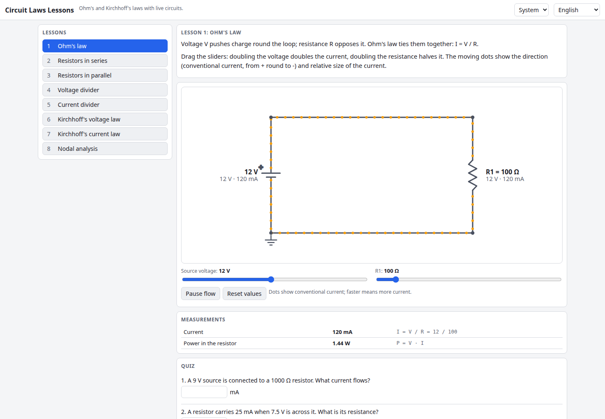

# Circuit Laws Lessons

Eight short interactive lessons on Ohm's law and Kirchhoff's laws. Each lesson has a live circuit solved in real time by a modified-nodal-analysis solver, animated current flow, sliders for every component, a measurements table and a randomised quiz. English and Ukrainian, light and dark theme, nothing leaves your browser.

**Try it:** https://hermes98761234.github.io/circuit-laws-lessons/

[](https://github.com/hermes98761234/circuit-laws-lessons/actions/workflows/deploy.yml)



## Features

- Lessons: Ohm's law, series, parallel, voltage divider, current divider, KVL, KCL, nodal analysis (Wheatstone bridge)
- Live circuits: sliders for voltage and resistances; voltages and currents on every element update instantly
- Animated conventional-current flow (speed follows the current, direction follows its sign; pause button; honours reduced-motion)
- KVL/KCL checks computed from the solution (the sums really come out as zero)
- Quizzes with random numbers, 2 % tolerance, best score saved per lesson in localStorage
- Deep links to lessons (`#lesson=4`), English/Ukrainian UI, light/dark/system theme

## How it works

`src/lib/circuit.ts` implements modified nodal analysis: unknowns are the node voltages plus the current of each voltage source or ideal wire; the system is solved by Gaussian elimination with partial pivoting. Tests check equivalent-resistance formulas, dividers, a Wheatstone bridge against a hand-solved nodal result, power conservation and KCL at every node of every lesson circuit.

## Quick start

```
npm install
npm run dev      # development server
npm test         # unit tests
npm run build    # production build in dist/
```

## License

MIT, see [LICENSE](LICENSE).
